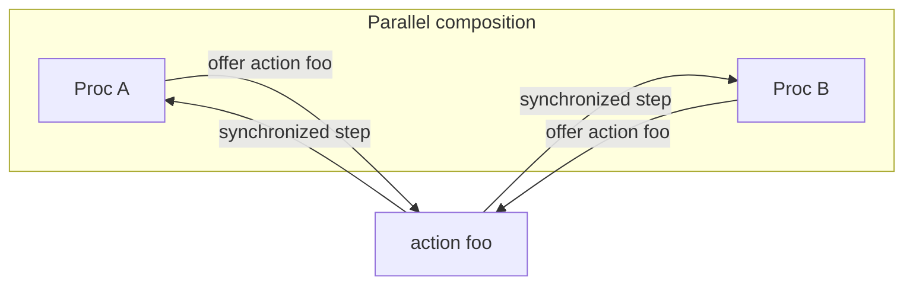

# Composition and actions

## Parallel composition

Compose procs with `||`:

```jul
proc IncServer := Counter || Printer || ServerLogic
```

Each component keeps its own state. They interact only by **synchronizing on shared actions**.

`||` is **occurrence-based** and **left-associative**: each mention of a proc class is a separate occurrence (`A || A` is two occurrences of `A`, not one). Do not confuse this with exchanging action arguments **by copy** (no shared references). A **`static proc`** may appear at most once in a composition.

### Channel keys and alphabets

| Kind | Channel | External alphabet |
|------|---------|-------------------|
| **`service` transition** | Public action name (global hub API) | Service **stays** external after clients meet it |
| **`client` transition** | Same public name as its service | Client **leaves** external when it syncs with the service |
| **Ordinary (untagged)** | Scope-private when peers meet under `||` | Both sides become **composition-hidden** at that compose step |
| **`internal` / `timer`** | Occurrence-local | Never in the external alphabet |

So `||` both **lists the members** of the system and **scopes ordinary syncs**: matching untagged offers under a compose step get a private channel key and disappear from the external alphabet. Nested assemblies do not cross-sync on the same ordinary name unless that name remains external (for example a still-unmatched ordinary, or a `service` hub).

```jul
proc X := A || B
proc Z := C || D
proc W := X || Z
```

If `A` and `B` both offer ordinary `y`, that pair becomes composition-private inside `X`. The same name on `C` / `D` is a separate scoped channel inside `Z` — not one global `y` across `W`.

Use **`service` / `client`** when a static hub must stay visible so many callers can sync on the same public API (see [inc server](../examples/inc-server.md)).

### Alphabet integrity and `unsynced`

**Complete sync** of ordinary actions is required by default on every top-level `compile` target (JAR and TLA). Intermediate assemblies (analyze / check without a `compile` directive) may still leave ordinary actions unbound.

On a top-level **JAR** target:

- Unsynced ordinary actions in the external alphabet → **error**. Tag them `internal` if a solo step is intentional (programs cannot declare an open-env allowlist).
- Dangling `client` with no `service` → **error** (except folded procfun clients waiting for a parent hub).
- Action-shape and static-occurrence errors are hard failures (see below).

On a top-level **TLA / composition Spec** target, dangling clients are still allowed, but unbound ordinary actions are an **error** unless listed on the Spec:

```jul
spec Sys := Cluster || Env {
  unsynced goInject, tick
}
```

The `unsynced` list is an **exact** allowlist of intentional open-env ordinary action names (unqualified; local to this Spec):

- Unbound ordinary **not** listed → error (forgotten peer).
- Name listed but **already synced** → error (stale declaration).
- Name listed but **absent** from the alphabet → error (typo).

Unbound **constructors** (other than `initially`) are included: list them in `unsynced` on a Spec, or sync them with a peer. `analyze`, IDE alphabet panels, and `check` without a `compile` directive do not require incomplete ordinary wiring yet.

### Procfuns and alphabets

Procfuns are **not** allowed in `||` (compile error). They are not composition peers. For **analyze / IDE alphabets**, any procfun **called** by a host under an assembly contributes its non-synthetic actions to that assembly. To **couple** a procfun in TLA+, list it in an [api](#apis)'s `calls:` (see below).

### TLA+ occurrence names

When emitting TLA+, a unique leaf class keeps its name. If class `X` appears more than once, every occurrence is renamed using the introducing assembly: `proc P := A || X` and `proc Q := B || X` composed together become `X_P` and `X_Q`. Same-parent ties (`proc P := X || X`) use `X_P_1`, `X_P_2`, …. Renamed state variables get `(* ... *)` comments. Julay invariants still write `X.n`; the compiler expands them per occurrence in TLA+.

Child-class occurrences use the inferred parent in the leaf name when needed (`BroadcastClaim_Put`, `BroadcastClaim_ApplyMoveBatch`). See [Parent/child inference](children.md).

## Parent/child procs and packaging

Apis and procfuns are removed. Package components with ordinary `||`; parenthood is inferred from nesting:

```jul
proc Sys := Boss || Worker
proc Tree := (Put || BroadcastClaim) || (ApplyMoveBatch || BroadcastClaim)
```

See [Parent/child inference](children.md) for declarations, returns, inference rules, and HTTP `~>`.

## Synchronization (language level)

When procs offer the **same action** with compatible arguments and guards, they take a **synchronized step** together — on a **service** public channel, or on a **composition-scoped** ordinary channel after `||` hides the pair.



Important consequences of Julay’s philosophy:

- Processes **do not share resources**; a proc may **interface** a resource for others.
- Action arguments are exchanged **by copy**, never by reference—no shared mutable objects across procs.

### Same class never syncs

**Two different occurrences of the same proc class never synchronize with each other** on ordinary or `internal` actions. Only **distinct proc classes** can pair on a shared action. Clients of the same `service` also never sync with each other — only with the service.

## Action shapes

For ordinary (non-`service`/`client`, non-`internal`, non-`timer`) multi-class offers that remain external, every offer of a given name must form one of these shapes:

| Shape | Who offers | Role |
|-------|------------|------|
| **Hub** | Exactly one **static** class + any number of **dynamic** classes | Static is the hub; dynamics are peers of that API |
| **Two statics** | Exactly two static classes, no dynamics | Peer sync between two statics |
| **Local / single class** | One class only | Unsynced / solo on that name (may warn on a binary target) |

Illegal (except parent↔child): dynamic↔dynamic only, three or more statics, or two-or-more statics plus a dynamic. Parent↔child ordinary sync is the one allowed dynamic↔dynamic case — see [Parent/child inference](children.md).

**`service` / `client`** pairs skip these ordinary-shape checks: the service is the hub; any number of clients may sync with it (never with each other). Prefer tagging static hub APIs as `service` and callers as `client` when the hub must stay in the external alphabet (multiple handlers, printers, nested assemblies). In TLA+, each peer is paired with the unique hub alone — for both `service`/`client` and ordinary static-hub shapes — including when two peers are parent/child of each other (matches Go hub channels). Parent↔child fusion is never used for hub APIs.

`static proc` classes may appear **at most once** in a composition. Only dynamic procs may be spawned via non-`initially` constructors.

## Sender / receiver deduction

At compile time the compiler analyzes guards and bodies to deduce **channel direction** (who sends, who receives) for each sync group. Checklist:

1. **Bindings.** `=` / `<=>` and membership `in` decide which peer owns which args. Equality wins over membership when both are present. A binder’s RHS may use already-bound args or args received from the other side.
2. **Direction.** Pairwise syncs try both orientations; hubs must be uniformly sender or receiver for every peer. Ties break toward **dynamic sends, hub receives**.
3. **Forward vs reply.** Sender-owned args travel on the forward message. Receiver-only args that the sender’s **body or residual guard** reads travel on a **reply** channel.
4. **No receiver filters on forward args.** The receiver must not residual-filter on sender-owned args. That shape would always-offer receives and nack/retry (message storms). Prefer a client-side check, **query then unconditional write**, or an explicit `ok <=> predicate` reply with a client branch on `ok` (see below).
5. **Reply commit filters.** The sender **may** residual-filter on reply args **only when the receiver is a pure query** (no `transit:`, `before:`, or `after:`). Example: Client sends `key`, Store replies `owner = if (key in owners) …`, Client guards `owner ~in setOf(me, emptyNode())` and only then takes transit. Go checks that residual **after** `<-reply`; if it fails, the sender skips fire (receiver had no effects). Fixture: [`regression/input/spec/reply-commit-filter.jul`](../../regression/input/spec/reply-commit-filter.jul).
6. **Go vs TLA.** Enablement may offer the send before reply filters are known; a failing filter skips sender effects (extra failed attempts vs TLC, where the joint guard never enables). Same fairness class as [sync starvation](#fairness) below.
7. **Unbound / relational-only.** Guards that never bind args fail compilation (they cannot lower to directed Go sends/receives).

Sender reply-filters when the receiver has effects remain illegal (would need two-phase commit before receiver transit).

### Conditional writes (not forward commit filters)

Do **not** write a mutating service that residual-filters on received args:

```jul
// Illegal direction: receiver filters on sender-owned key/owner
service transition putKVIfOwner(key : Key, val : Value, owner : Node) {
    guard: owners[key] in setOf(owner, emptyNode())
    transit: store[key] := val
}
```

Use a result reply instead (always sync; client leaves the retry step on failure):

```jul
service transition putKVIfOwner(key : Key, val : Value, owner : Node, ok : Boolean) {
    guard: ok <=> (owners[key] in setOf(owner, emptyNode()))
    transit: store := if (ok) { /* put key */ store } else { store }
}
client transition putKVIfOwner(...) {
    guard: step = "putKV" & key = putKey & ...
    transit: step := if (ok) { "broadcast" } else { "redirect" }
}
```

### `arg in S` (random choice)

Membership in a guard can **bind** an argument by choosing uniformly from a set (runtime `ChooseUniformFiltered`). Equality bindings win over membership when both are present. Example: [`regression/input/set/random-choice-from-set.jul`](../../regression/input/set/random-choice-from-set.jul).

## Action modifiers

| Modifier | Role |
|----------|------|
| *(none)* | Ordinary rendezvous; composition-private when peers meet under `||` |
| `service` | Hub API; stays external; public action-name channel |
| `client` | Syncs only with a matching `service` |
| `internal` | Occurrence-local solo step (no cross-class pairing) |
| `timer` | Occurrence-local timer fire; arm with `setTimer` / `cancelTimer` — see [Effects](effects.md) |

Examples:

```jul
service transition increment() { ... }      // static hub API
client transition increment() { ... }       // handler / printer caller
transition peerHandoff(x : Int) { ... }     // ordinary; scoped when || meets
internal transition println(msg : String) { ... }
timer transition timeout() { ... }
```

## Offering the same action

Different classes declare the same action name. For a shared hub API, mark the resource as `static proc` with **`service` transitions**, and tag handlers / printers / procfun callers as **`client`**. For example, `Counter` exposes `service` `increment` / `getCounter` while `incHandler` and `Printer` use `client` ([inc server](../examples/inc-server.md)).

Leave **ordinary** (untagged) syncs for two-static peers or composition-private pairs that should not remain in the external alphabet.

## Fairness

Generated TLA+ specs use `Fairness == SF_vars(Next)`: if any `Next` arm is enabled infinitely often, a non-stuttering step must occur infinitely often. That covers internals, timers, returns, synchronizations, and unsynchronized / environment arms, so a done dynamic proc cannot stutter forever while its return stays enabled.

Dynamic slots are **one-shot** in TLA (`retired` after return; see [Children — TLA](children.md#tla)): open-env schedules that starve a live worker by forever reconstructing another class on the same `DynProc` id are not in the model. Compound `SF_vars(Next)` remains.

This is an idealization of the outside world (the environment is not obligated to act in Go) and of synchronizations: in Go, a sync fires only when one side is parked waiting on the other. A proc that always has some local action ready never parks. So if *both* sides of a sync always have local work, the sync can be starved indefinitely, even though TLC assumes it eventually fires.

For local actions, SF matches the Go runtime more closely: a proc's `select` chooses uniformly at random among its ready cases, so an action that is enabled infinitely often is taken with probability 1.

```jul
proc A { var n : Int := 0  internal transition tick() { transit: n := n + 1 }  transition ping() { } }
proc B { var m : Int := 0  internal transition tock() { transit: m := m + 1 }  transition ping() { } }
A || B   // TLC: ping eventually fires.  Go: ping may never fire.
```

Liveness properties proved by TLC (including each dynamic proc's `Terminates` property) hold for the Go program only if no synchronization the property depends on is starved this way. In practice, avoid procs that spin on internal actions while also waiting on a sync.

Explicit angle-bracket AG Obls (`<A> Sys <G>`) use a safety-only default `.cfg` (`SpecSafety`, no `PROPERTY *Terminates`). Trailing `Sys |= G` and plain systems still list `*Terminates` even with `unsynced` open-env arms. See [Specifications — Explicit AG Obl `.cfg`](specifications.md#explicit-ag-obl-cfg-safety-by-default-no-terminates).

## See also

- [Processes](processes.md) — `static proc` vs dynamic
- [Parent/child inference](children.md) — nested `||`, returns, HTTP `~>`
- [Compiler optimizations](compiler-optimizations.md) — compile-time direction analysis
- [Creating libraries](creating-libraries.md)
