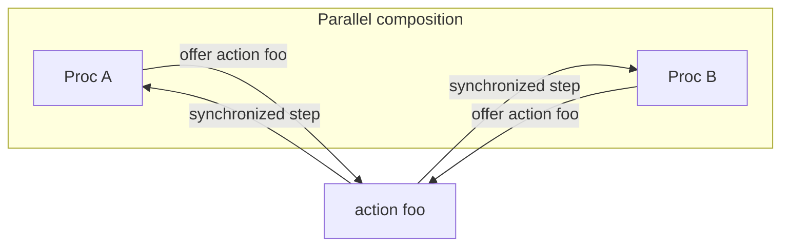

# Composition and actions

## Parallel composition

Compose procs with `||`:

```jul
proc IncServer := Counter || Printer || ServerLogic
```

Each component keeps its own state. They interact only by **synchronizing on shared actions**.

`||` is **occurrence-based** and **left-associative**: each mention of a proc class is a separate occurrence (`A || A` is two occurrences of `A`, not one). Do not confuse this with exchanging action arguments **by copy** (no shared references). A **`static proc`** may appear at most once in a composition.

### Channel keys and alphabets

| Kind | Channel | External alphabet |
|------|---------|-------------------|
| **`service` transition** | Public action name (global hub API) | Service **stays** external after clients meet it |
| **`client` transition** | Same public name as its service | Client **leaves** external when it syncs with the service |
| **Ordinary (untagged)** | Scope-private when peers meet under `||` | Both sides become **composition-hidden** at that compose step |
| **`internal` / `timer`** | Occurrence-local | Never in the external alphabet |

So `||` both **lists the members** of the system and **scopes ordinary syncs**: matching untagged offers under a compose step get a private channel key and disappear from the external alphabet. Nested assemblies do not cross-sync on the same ordinary name unless that name remains external (for example a still-unmatched ordinary, or a `service` hub).

```jul
proc X := A || B
proc Z := C || D
proc W := X || Z
```

If `A` and `B` both offer ordinary `y`, that pair becomes composition-private inside `X`. The same name on `C` / `D` is a separate scoped channel inside `Z` — not one global `y` across `W`.

Use **`service` / `client`** when a static hub must stay visible so many callers can sync on the same public API (see [inc server](../examples/inc-server.md)).

### Alphabet integrity (native binary only)

**Complete sync** of ordinary / client actions is required only on the **top-level native `compile` target** — not on intermediate apis or procs that a parent will compose later, and not when compiling to TLA+ (`spec` or `--compile-tla`).

On that top-level binary target:

- Unsynced ordinary actions in the external alphabet → **warn** (compile still succeeds). Tag them `internal` if a solo step is intentional.
- Dangling `client` with no `service` → **error** (except folded procfun clients waiting for a parent hub).
- Action-shape and static-occurrence errors are hard failures (see below).

TLA+ compile skips composition-alphabet checks entirely, so partial specs are allowed.

`analyze`, IDE alphabet panels, and `check` without a `compile` directive do not require incomplete ordinary wiring to be resolved yet.

### Procfuns and alphabets

Procfuns are **not** allowed in `||` (compile error). They are not composition peers. For **analyze / IDE alphabets**, any procfun **called** by a host under an assembly contributes its non-synthetic actions to that assembly. To **couple** a procfun in TLA+, list it in an [api](#apis)'s `calls:` (see below).

### TLA+ occurrence names

When emitting TLA+, a unique leaf class keeps its name. If class `X` appears more than once, every occurrence is renamed using the introducing assembly: `proc P := A || X` and `proc Q := B || X` composed together become `X_P` and `X_Q`. Same-parent ties (`proc P := X || X`) use `X_P_1`, `X_P_2`, …. Renamed state variables get `(* ... *)` comments. Julay invariants still write `X.n`; the compiler expands them per occurrence in TLA+.

Procfun leaves use their **stable id** as the class name (`RpcOut_keyCount`, not bare `keyCount`), so two modules’ same-bare helpers stay distinct before occurrence renaming. User transitions inside a procfun keep source action names (still sync by action name with peers).

## APIs

An **api** packages a resident parallel composition (`proc:`) with optional procfun entry points (`calls:`). Conceptually it is one composition unit:

```jul
api RpcOut := <proc-field> || <call₁> || <call₂> || …
```

Operationally, only `proc:` leaves are started as composition peers; `calls` participate in alphabet and TLA coupling, and are still spawn-awaited when invoked.

### Syntax

```jul
export api RpcOut {
    proc: RpcOutClient
    calls: rpcOutClientCaller, outRequestVoteRPC, outAppendEntriesRPC
}
```

- `proc:` — required; parallel composition of **procs and/or apis** only (procfun names are illegal here, as in any `||`).
- `calls:` — optional; comma-separated procfun names owned by this api.

### Author mental model

As the api author, treat everything in the api as one parallel composition: the `proc:` peers plus each `calls` procfun. Matching actions sync under the service/client or ordinary composition rules above. Incomplete wiring is allowed at declaration time:

```jul
export api RpcOut {
    proc: RpcOutClient
    calls: rpcOutClientCaller
}
```

This is legal. `rpcOutClientCaller`'s actions that do not meet a peer inside the api remain **external actions of `RpcOut`** (visible in `analyze -s RpcOut` and the VS Code alphabet panel). A parent may still compose a partner that syncs those actions. `compile RpcOut` yields the usual unsynced ordinary **warning** (same as proc assemblies), not a hard error.

### Consumer mental model

Consumers treat an api as:

1. A process-like unit to compose: `… || RpcOut || …`
2. Qualified call entry points: `RpcOut.outRequestVoteRPC(...)`

```jul
import node.rpc_out.RpcOut

// compose
proc System := Client || RpcOut

// call — no separate import of outRequestVoteRPC required
transit:
    let ok : Boolean := RpcOut.outRequestVoteRPC(peer, payload)
```

- `import path.Api` is enough to compose that api and to call every procfun listed in its `calls:` as `Api.fn(...)`. Those procfuns need not be `export`ed (and usually should not be — the api is the public surface).
- Outside the api, listed procfuns **must** be called as `ApiName.fn(...)` (not bare `fn(...)`).
- Inside other procfuns of the same module, bare calls to siblings remain allowed.
- `ApiName.fn(...)` requires a **unique** occurrence of that api in the enclosing composition (error if missing or duplicated).
- Procfuns listed in `calls:` get stable IR/TLA/Go ids `ApiName_fn` (see [Procfuns](procfun.md)); the same bare `fn` may exist in another module without colliding.

### Nesting

Apis may appear in other apis' `proc:` fields and in ordinary `||`:

```jul
export api RaftNode {
    proc: RaftNodeMain || RaftCore || RpcOut || RpcIn
}
```

Nested api `calls` stay in the nested scope; a parent does not automatically re-export child calls.

### Specs and TLA+

Apis are valid systems wherever procs are:

```jul
api RpcOut1 {
    proc: RpcOutClient
    calls: rpcOutClientCaller
}
spec RpcOutSpec1 := RpcOut1
// TLA models RpcOutClient || rpcOutClientCaller (caller coupled)

api RpcOut2 {
    proc: RpcOutClient
}
spec RpcOutSpec2 := RpcOut2
// TLA models RpcOutClient only

spec WithInv := RpcOut1 |= SomeInv
spec AG := <Env> RpcOut1 <Guarantees>
```

| Situation | TLA |
|-----------|-----|
| Procfun listed in `calls` of an api in the composition | **Coupled** |
| Procfun called but not listed in any composed api's `calls` | **Havoc** + warning |
| Procfun name written in `\|\|` | **Compile error** |

### Parallel composition may only use procs and apis

```jul
// ERROR
proc Bad := Main || countUp
```

Use an api instead:

```jul
api CountUpApi {
    proc: Main
    calls: countUp
}
spec CountUpSpec := CountUpApi
```

## Synchronization (language level)

When procs offer the **same action** with compatible arguments and guards, they take a **synchronized step** together — on a **service** public channel, or on a **composition-scoped** ordinary channel after `||` hides the pair.



Important consequences of Julay’s philosophy:

- Processes **do not share resources**; a proc may **interface** a resource for others.
- Action arguments are exchanged **by copy**, never by reference—no shared mutable objects across procs.

### Same class never syncs

**Two different occurrences of the same proc class never synchronize with each other** on ordinary or `internal` actions. Only **distinct proc classes** can pair on a shared action. Clients of the same `service` also never sync with each other — only with the service.

## Action shapes

For ordinary (non-`service`/`client`, non-`internal`, non-`timer`) multi-class offers that remain external, every offer of a given name must form one of these shapes:

| Shape | Who offers | Role |
|-------|------------|------|
| **Hub** | Exactly one **static** class + any number of **dynamic** classes | Static is the hub; dynamics are peers of that API |
| **Two statics** | Exactly two static classes, no dynamics | Peer sync between two statics |
| **Local / single class** | One class only | Unsynced / solo on that name (may warn on a binary target) |

Illegal: dynamic↔dynamic only, three or more statics, or two-or-more statics plus a dynamic.

**`service` / `client`** pairs skip these ordinary-shape checks: the service is the hub; any number of clients may sync with it (never with each other). Prefer tagging static hub APIs as `service` and callers as `client` when the hub must stay in the external alphabet (multiple handlers, printers, nested assemblies).

`static proc` classes may appear **at most once** in a composition. Only dynamic procs may be spawned via non-`initially` constructors.

## Sender / receiver deduction

At compile time the compiler analyzes guards and bodies to deduce **channel direction** (who sends, who receives) for each sync group:

- Bindings from `=` / `<=>` and membership `in` decide which peer owns which args.
- For a hub, direction must be uniform; ties break toward **dynamic sends, hub receives**.
- **Reply args:** arguments bound only on the receiver that the **sender’s body** still reads travel on a reply channel.
- Receiver guards must not residual-filter on sender-owned args; sender guards must not reference reply args.

Relational-only guards that never bind args fail compilation (they cannot lower to directed Go sends/receives).

### `arg in S` (random choice)

Membership in a guard can **bind** an argument by choosing uniformly from a set (runtime `ChooseUniformFiltered`). Equality bindings win over membership when both are present. Example: [`regression/input/set/random-choice-from-set.jul`](../../regression/input/set/random-choice-from-set.jul).

## Action modifiers

| Modifier | Role |
|----------|------|
| *(none)* | Ordinary rendezvous; composition-private when peers meet under `||` |
| `service` | Hub API; stays external; public action-name channel |
| `client` | Syncs only with a matching `service` |
| `internal` | Occurrence-local solo step (no cross-class pairing) |
| `timer` | Occurrence-local timer fire; arm with `setTimer` / `cancelTimer` — see [Effects](effects.md) |

Examples:

```jul
service transition increment() { ... }      // static hub API
client transition increment() { ... }       // handler / printer caller
transition peerHandoff(x : Int) { ... }     // ordinary; scoped when || meets
internal transition println(msg : String) { ... }
timer transition timeout() { ... }
```

## Offering the same action

Different classes declare the same action name. For a shared hub API, mark the resource as `static proc` with **`service` transitions**, and tag handlers / printers / procfun callers as **`client`**. For example, `Counter` exposes `service` `increment` / `getCounter` while `incHandler` and `Printer` use `client` ([inc server](../examples/inc-server.md)).

Leave **ordinary** (untagged) syncs for two-static peers or composition-private pairs that should not remain in the external alphabet.

## See also

- [Processes](processes.md) — `static proc` vs dynamic
- [Procfuns](procfun.md) — call-site alphabet folding; packaging via [apis](#apis)
- [Compiler optimizations](compiler-optimizations.md) — compile-time direction analysis
- [Creating libraries](creating-libraries.md)
